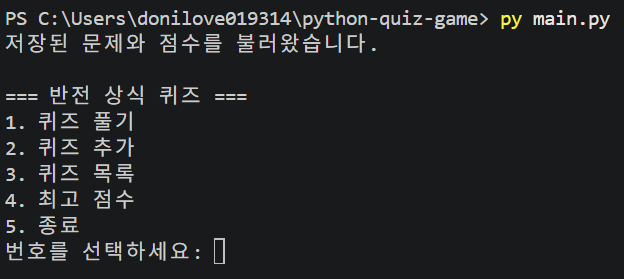
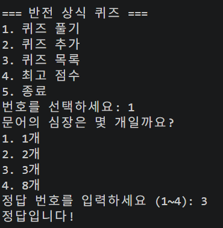
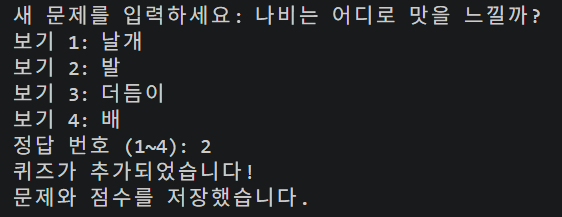
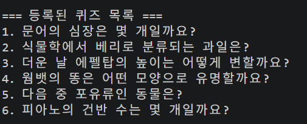
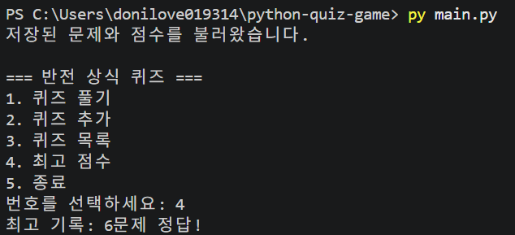
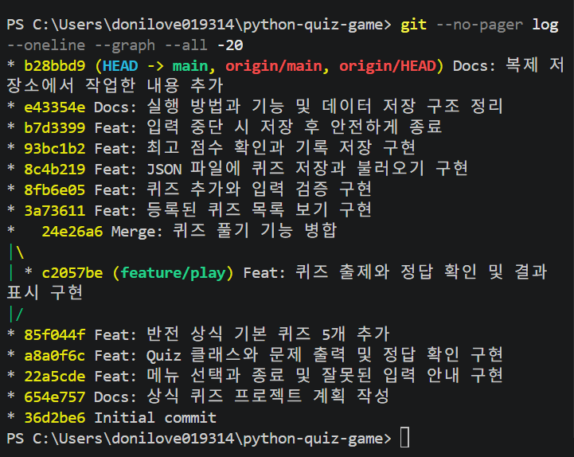
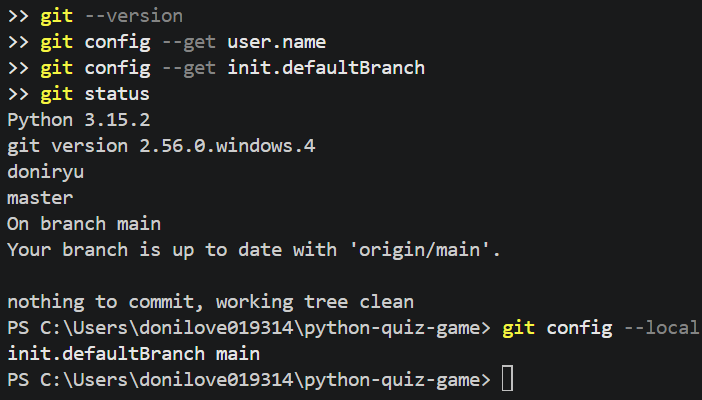

# 반전 상식 퀴즈 게임

## 프로젝트 개요
Python으로 만든 터미널 퀴즈 게임입니다.
퀴즈 풀기, 추가, 목록 보기, 최고 기록 확인 기능을 제공합니다.
문제와 최고 기록은 state.json에 저장되어 재실행해도 유지됩니다.

## 주제 선정 이유
예상과 다른 답을 알아가는 재미를 느낄 수 있도록
동물, 과일, 건축물 등의 반전 상식을 주제로 선택했습니다.
기본 문제는 4지선다형 5개입니다.

## 개발 환경
- Windows 11
- Visual Studio Code
- Python 3.15.2
- 외부 라이브러리 없이 Python 표준 라이브러리 사용

## 실행 방법
Python 3.10 이상과 Git이 설치된 환경에서 실행합니다.

```powershell
git clone https://github.com/doniryu/python-quiz-game.git
cd python-quiz-game
py main.py
```

macOS와 Linux에서는 실행 명령으로 `python3 main.py`를 사용합니다.

## 기능 목록
1. 퀴즈 풀기: 모든 문제를 출제하고 정답 여부와 결과를 표시합니다.
2. 퀴즈 추가: 문제, 보기 4개, 정답 번호를 입력받습니다.
3. 퀴즈 목록: 등록된 문제 제목을 표시합니다.
4. 최고 점수: 지금까지 가장 많이 맞힌 문제 수를 표시합니다.
5. 종료: 데이터를 저장하고 종료합니다.

점수는 백분율이 아닌 정답 개수입니다.
아직 한 문제도 맞히지 않았다면 정답 기록이 없다고 안내합니다.

## 파일 구조
- main.py: 메뉴 선택과 종료 처리
- quiz.py: 문제 하나를 표현하는 Quiz 클래스
- questions.py: 기본 상식 문제 5개
- game.py: 게임을 관리하는 QuizGame 클래스와 저장·불러오기
- state.json: 퀴즈와 최고 기록 저장
- .gitignore: 임시 파일 등을 Git 관리에서 제외
- README.md: 프로젝트 설명과 실행 안내

## 데이터 파일 설명
state.json은 프로젝트 폴더에 UTF-8로 저장합니다.
실행 위치가 달라도 game.py가 있는 폴더에서 파일을 찾습니다.

- quizzes: 저장된 문제 목록
- question: 문제 내용
- choices: 보기 4개
- answer: 정답 번호인 1~4의 정수
- best_score: 최고 정답 개수

문제를 추가하거나 한 게임을 끝내거나 프로그램을 종료할 때 저장합니다.
저장 파일이 없으면 기본 문제와 최고 기록 0으로 시작합니다.
파일을 읽을 수 없거나 데이터가 잘못되면 안내 후 기본값으로 시작합니다.
이 상태에서 종료하면 기본값이 저장되므로,
기존 파일을 보존하려면 실행 전에 별도로 복사해야 합니다.

## 입력과 오류 처리
- 입력 앞뒤의 공백을 제거합니다.
- 빈 문제와 빈 보기는 다시 입력받습니다.
- 메뉴와 정답 번호의 허용 범위를 확인합니다.
- 잘못된 입력에는 안내 후 다시 입력받습니다.
- Ctrl+C와 입력 종료(EOFError) 발생 시 안내하고 저장 후 종료합니다.
- 작성 중인 문제와 진행 중인 게임 점수는 저장하지 않습니다.
- 파일 저장 실패 시 안내 메시지를 표시합니다.

## 직접 확인한 결과
- 퀴즈 추가 후 목록에 표시되는 것을 확인했습니다.
- 프로그램을 종료하고 다시 실행해도 추가한 문제가 유지됐습니다.
- 최고 기록 표시와 재실행 후 유지 여부를 확인했습니다.
- 메뉴 입력 중 Ctrl+C를 눌러 안내와 저장 후 종료되는 것을 확인했습니다.

## Git 작업 과정
- 기능별로 작업 내용을 설명하는 커밋을 남겼습니다.
- feature/play 브랜치에서 퀴즈 풀기를 구현했습니다.
- main 브랜치에 병합 기록을 남기며 합쳤습니다.
- GitHub에 작업 결과를 업로드했습니다.

기록 확인 명령:

```powershell
git log --oneline --graph --all
```


복제한 저장소에서도 작업하고 변경 내용을 공유할 수 있습니다.

## 실행 화면

### 메뉴


### 퀴즈 풀기


### 퀴즈 추가


### 퀴즈 목록


### 최고 점수


### Git 작업 기록


## 저장소 복제와 변경 가져오기 실습
1. 별도 폴더 python-quiz-game-copy에 저장소를 clone했습니다.
2. 복사본의 README에 문장을 추가하고 commit과 push를 했습니다.
3. 원래 작업 폴더에서 git pull --ff-only를 실행했습니다.
4. README 마지막 부분에 추가한 문장이 반영된 것을 확인했습니다.

## 개발 환경 확인
- Python: 3.15.2
- Git: 2.56.0.windows.4
- 작업 브랜치: main



## Git 커밋 수와 작업 규칙
기록 수집 시점에 현재 브랜치의 커밋은 17개입니다.
이후 보완 작업으로 개수는 늘어날 수 있습니다.
기능 구현, 문서 작성, 코드 정리를 각각 구분하여 기록했습니다.

- [실제 커밋과 병합 기록](docs/logs/git-history.txt)
- [기록 수집 시점의 커밋 개수](docs/logs/commit-count.txt)

### 커밋 단위
하나의 기능이나 목적을 하나의 커밋으로 묶습니다.
예를 들어 메뉴, 문제 모델, 기본 문제, 퀴즈 풀기,
목록 보기, 문제 추가, 파일 저장, 최고 기록을 나누어 구현했습니다.

### 커밋 메시지 형식
`종류: 변경 내용 요약` 형식을 사용합니다.

- Feat: 새로운 기능 추가
- Fix: 오류 수정
- Docs: 설명서와 증거 자료 추가
- Refactor: 동작을 유지하면서 코드 구조 정리

실제 예: `Feat: 최고 점수 확인과 기록 저장 구현`

## 클래스로 나눈 이유
Quiz는 문제, 보기, 정답과 정답 확인 기능을 묶은 문제 카드입니다.
게임 진행자는 카드 내부의 세부 구현을 몰라도
display()와 check_answer()를 호출하여 사용할 수 있습니다.
이렇게 필요한 기능만 드러내는 것이 추상화입니다.

같은 Quiz 틀로 기본 문제와 사용자가 추가한 문제를 모두 만들므로
출력과 정답 확인 코드를 문제마다 반복해서 작성할 필요가 없습니다.
이것이 재사용의 이점입니다.

QuizGame은 문제 목록, 게임 진행, 최고 기록과 파일 저장을 담당합니다.
문제 카드의 동작과 게임 전체의 흐름을 나누어 수정하기 쉽게 했습니다.

## JSON을 선택한 이유
JSON은 문제 목록, 보기 목록, 정답 번호와 점수를 구조적으로 담을 수 있습니다.
텍스트 편집기로 내용을 읽을 수 있고,
Python 표준 라이브러리 json으로 저장하고 불러올 수 있습니다.
다른 언어에서도 널리 지원하므로 데이터를 옮기기에도 편리합니다.
한글을 읽기 쉽게 UTF-8과 ensure_ascii=False를 사용합니다.

## 프로그램 호출 흐름
실행 → QuizGame 생성 → 저장 파일 불러오기 → 메뉴 선택 →
선택한 기능 실행 → 변경 내용 저장 → 종료 시 저장 순서입니다.

## 대량 데이터에 대한 고려
현재 프로그램은 소규모 학습용이며,
1,000개 이상의 데이터에 대한 성능과 메모리는 아직 측정하지 않았습니다.

문제 수를 n이라고 할 때:
- 파일 불러오기는 모든 문제를 읽으므로 시간과 메모리가 문제 수에 비례합니다.
- 목록 보기와 전체 퀴즈 풀기도 모든 문제를 순회합니다.
- 저장할 때 전체 문제를 변환하고 파일 전체를 다시 작성합니다.
- 긴 문제나 많은 보기가 있으면 파일 크기와 메모리 사용량이 증가합니다.
- 현재 별도의 검색 기능과 검색 인덱스는 없습니다.

문제가 많아지면 목록을 페이지별로 출력하고,
게임에서 출제할 문제 수를 제한하는 방법을 고려할 수 있습니다.
반복 검색이 필요하면 문제 ID를 키로 하는 사전이나
SQLite 인덱스를 검토할 수 있습니다.
매우 큰 데이터에는 전체 JSON을 한 번에 읽는 대신
JSON Lines의 줄 단위 처리나 데이터베이스 사용을 검토합니다.
이러한 개선은 현재 구현된 기능이 아닌 향후 설계 방향입니다.

## 요구사항 변경 시 수정할 곳
- [ ] 점수를 백분율로 변경:
  game.py의 play() 계산, show_score() 표시와 README를 수정합니다.
  state.json의 기존 best_score는 정답 개수이므로
  변환 기준이나 초기화 정책도 정해야 합니다.
- [ ] 보기 개수 변경:
  quiz.py의 문제 모델, questions.py의 기본 문제,
  game.py의 입력 범위·보기 등록·불러오기 검증을 함께 수정합니다.
  기존 저장 데이터와의 호환성도 확인합니다.
- [ ] 문제에 해설 추가:
  Quiz 속성, 기본 문제, 문제 추가 입력, to_dict(),
  파일 불러오기와 결과 출력을 함께 수정합니다.
- [ ] 저장 형식 변경:
  save_state(), load_state(), 데이터 설명과
  기존 파일을 새 형식으로 옮기는 절차를 수정합니다.

  ## 자동 백업과 복구

- 저장할 때 임시 파일에 먼저 기록한 뒤 state.json을 교체합니다.
- state.json.bak에 최근 저장 내용 1개를 자동으로 보관합니다.
- 실행할 때 state.json을 먼저 읽고 데이터 형식을 검사합니다.
- 원본이 없거나 손상되었으면 백업 파일을 검사하여 불러옵니다.
- 두 파일 모두 사용할 수 없으면 안내 후 기본 문제와 0점으로 시작합니다.
- 백업은 최근 저장본 1개이며, 여러 시점의 기록을 보관하지는 않습니다.

### 저장 오류가 발생했을 때

1. 프로그램을 종료하기 전에 화면의 오류 안내를 확인합니다.
2. 프로젝트 폴더에 파일을 쓸 권한과 디스크 여유 공간이 있는지 확인합니다.
3. 필요하면 쓰기 가능한 개인 폴더로 프로젝트 전체를 복사합니다.
4. 수동 복구 전에는 현재 state.json과 state.json.bak을 별도로 복사합니다.
5. 정상 백업을 사용하려면 프로그램을 종료하고 state.json.bak을
   state.json으로 복사한 뒤 다시 실행합니다.

   ## 백업 복구 실행 확인

저장 파일을 일부러 손상시킨 뒤 프로그램을 실행하여,
자동 백업에서 기존 문제 7개를 불러오는 것을 확인했습니다.

- [복구 실행 기록](docs/logs/recovery-test.txt)
- 저장 시 임시 파일을 작성한 뒤 원본을 교체합니다.
- state.json.bak에는 최근 저장본 1개를 보관합니다.
- 원본을 읽을 수 없으면 백업을 검사하여 복구합니다.
- 원본과 백업 모두 사용할 수 없으면 기본 문제로 시작합니다.
